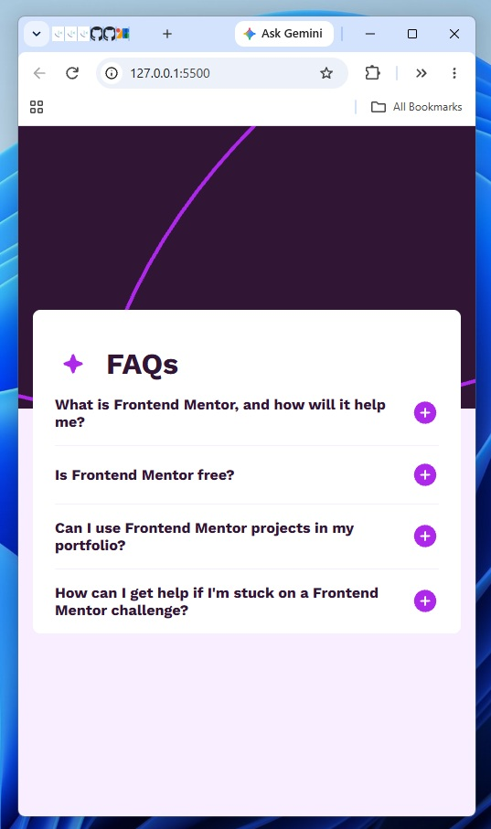

# Frontend Mentor - FAQ accordion solution

This is a solution to the [FAQ accordion challenge on Frontend Mentor](https://www.frontendmentor.io/FAQ-accordion--wyfFdeBwBz). Frontend Mentor challenges help you improve your coding skills by building realistic projects. 

## Table of contents

- [Overview](#overview)
  - [The challenge](#the-challenge)
  - [Screenshot](#screenshot)
  - [Links](#links)
- [My process](#my-process)
  - [Built with](#built-with)
  - [What I learned](#what-i-learned)
    - [Achievements](#achievements)
    - [Challenges](#challenges)
    - [Continued development](#continued-development)
  - [AI Collaboration](#ai-collaboration)

## Overview

### The challenge

Users should be able to:

- View the optimal layout depending on their device's screen size

### Screenshot

- Note that the difference between mobile, tablet and desktop designs are very minimal (slightly larger heading for tablet/desktop) and so therefore it would be unnecessary to show multiple screenshots at this moment. 

### Links

- Solution URL: [GitHub repo](https://github.com/Acemeistre/FEM_FAQ-accordion/)
- Live Site URL: [Live site](https://acemeistre.github.io/FEM_FAQ-accordion/)

## My process

### Built with

- Semantic HTML5 markup
- CSS custom properties
- Flexbox
- CSS Grid

### What I learned

#### Achievements

- Built a semantic, accessible HTML structure using a `<ul>` of `.item` list entries, pairing `<button>` elements with `aria-expanded` and `aria-controls` attributes linked to each answer's `id`.
- Used CSS attribute selectors (`[aria-expanded="true"]`) alongside `:has()` on the parent `.item` to swap the plus/minus icons and reveal answers purely through state changes, without touching inline styles in JavaScript.
- Wrote my first interactive JavaScript toggle using `querySelectorAll`, `.forEach()`, `addEventListener`, `getAttribute`, and `setAttribute` to handle multiple accordion buttons at once.
- Styled hover and keyboard `:focus-visible` states using `--color-violet` to match the component variants in the Figma design file.

#### Challenges

- Struggled with CSS state selectors despite having used them in previous projects—initially mixing up `[hidden]` and `[open]` (from `
`) on a `<button>`, where the actual state attribute is `aria-expanded`.
- Because each `<button>` sits inside an `<h2>`, an adjacent sibling combinator (`+`) couldn't reach `.answer`, so I had to use `:has()` on `.item` to style the answer when its child button is expanded.
- Linked the JavaScript file using `<link href="index.js">` and then ``.
- Debugging JavaScript syntax while learning — mixing up `getElementById` with attribute selectors, forgetting quotes around attribute names, and confusing the `buttons` NodeList with the individual `button` parameter inside `.forEach()`.
- Needed step-by-step guidance to write my first interactive JavaScript toggle—working through `querySelectorAll`, `.forEach()`, `addEventListener`, `getAttribute`, and `setAttribute` syntax, as well as mixing up the `buttons` NodeList with the individual `button` parameter inside the loop.

#### Continued development/help

- Practice writing `querySelectorAll`, `.forEach()`, and `addEventListener` patterns from memory so the syntax becomes second nature.
- Get more comfortable using `:has()` and ARIA state attributes (`aria-expanded`, `aria-controls`) to drive CSS transitions and UI states.
- Revisit CSS attribute selectors (`[aria-expanded="true"]`) and `:has()` so targeting component states feels solid without second-guessing or relying on AI.

## AI Collaboration

- Tools used - Claude and Google AI.
- Used for - debugging and brainstorming solutions.